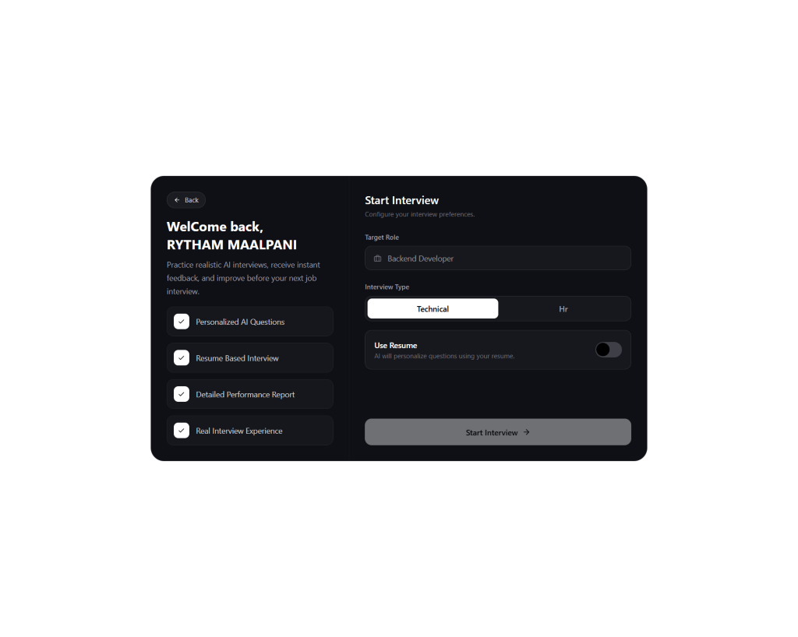
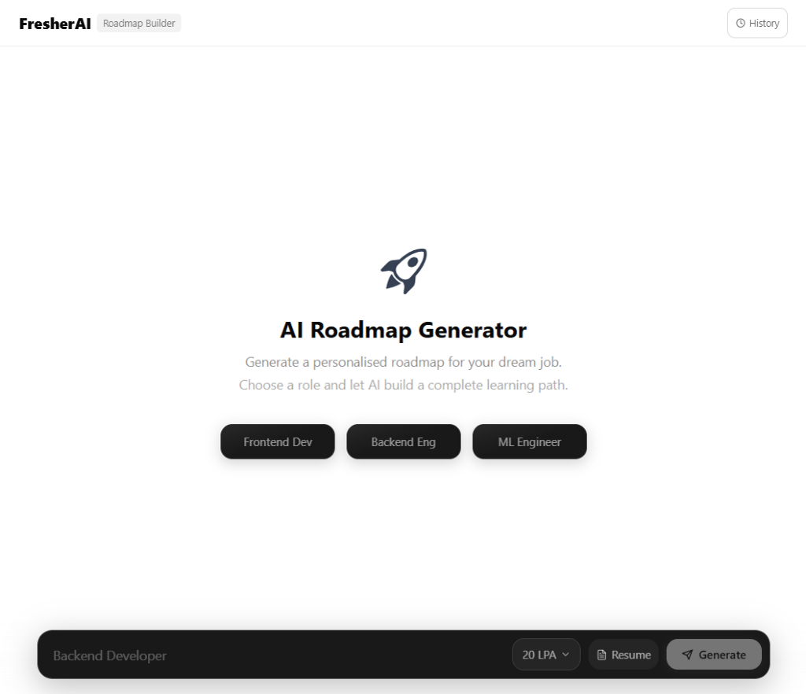
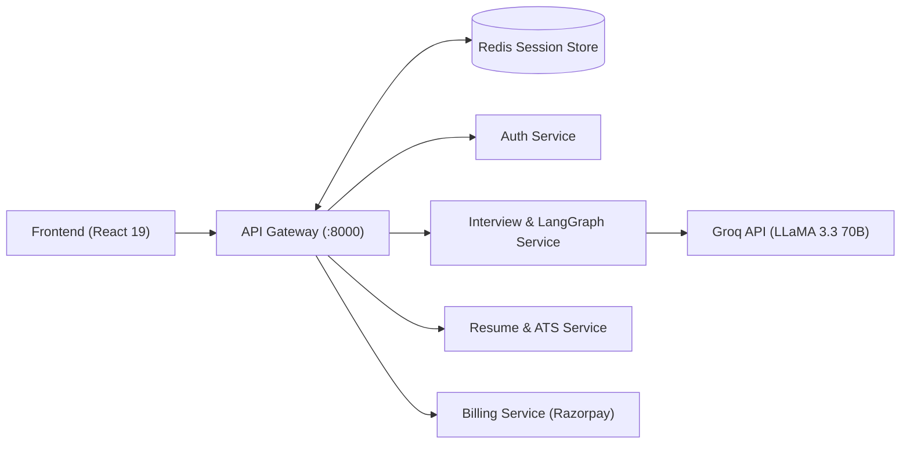

# PanelPilot

> Technical interview simulator and placement prep platform with multi-agent evaluation, live voice/code workspaces, ATS resume scoring, and personalized roadmaps.

[](https://react.dev/)
[](https://nodejs.org/)
[](https://expressjs.com/)
[](https://langchain-ai.github.io/langgraphjs/)
[](https://www.mongodb.com/)
[](https://redis.io/)

---

## Overview

Practicing coding problems alone doesn't prepare you for actual technical interviews, which require articulating thought processes under time pressure and defending design tradeoffs.

I built **PanelPilot** to simulate a real engineering panel:
- **LangGraph Multi-Agent Workflows**: Choreographs interviewer, feedback, and summary agents to adaptively question and evaluate candidates.
- **Live Interactive Workspace**: Integrated Monaco code editor with multi-language support, browser speech recognition, and audio synthesis.
- **ATS Resume Intelligence**: Scores resumes against target roles, extracts key skill gaps, and suggests tailored improvements.
- **Adaptive Roadmaps**: Generates step-by-step topic modules combined with curated video learning resources.

---

## Screenshots

| Dashboard & Radar Analytics | Interview Setup |
| :---: | :---: |
|  |  |

| ATS Resume Scorer | Resume Builder |
| :---: | :---: |
|  |  |

| Personalized Learning Roadmap | Billing & Coins System |
| :---: | :---: |
|  |  |

---

## Architecture



---

## Key Highlights

- **Multi-Agent State Machine**:
  - `InterviewAgent`: Evaluates candidate resume context and seniority to pose adaptive technical questions.
  - `FeedbackAgent`: Evaluates answers across clarity, correctness, and technical depth.
  - `SummaryAgent`: Synthesizes final scorecards with categorized strengths and improvement notes.
- **Live Workspace**: In-browser speech recognition and synthesis paired with an embedded Monaco code editor for real-time coding rounds.
- **API Gateway Routing**: Requests pass through a central gateway verifying session tokens against Redis before proxying to internal domain services.

---

## Tech Stack

- **Frontend**: React 19, Vite, Redux Toolkit, Tailwind CSS, Monaco Editor, Recharts, Framer Motion
- **Backend**: Node.js, Express 5, LangGraph.js, LangChain Core, Firebase Admin SDK
- **Databases**: MongoDB Atlas (persisted interviews and scorecards), Redis (session tokens and rate limits)
- **External Integrations**: Groq Cloud (LLaMA 3.3 70B inference), Razorpay, YouTube Data API v3

---

## Setup & Local Run

### Prerequisites
- Node.js 20+
- MongoDB and Redis instances
- API keys: Groq Cloud, Firebase Admin, Razorpay

### 1. Clone & Install
```bash
git clone https://github.com/V-Rytham/PanelPilot.git
cd PanelPilot
npm install
```

### 2. Environment Configuration
Populate `.env` files in `backend/gateway`, `backend/services/*`, and `frontend/` with service ports and API credentials.

### 3. Start Development Services
```bash
npm run dev
```

The frontend runs at `http://localhost:5173` and the API gateway listens on `http://localhost:8000`.
