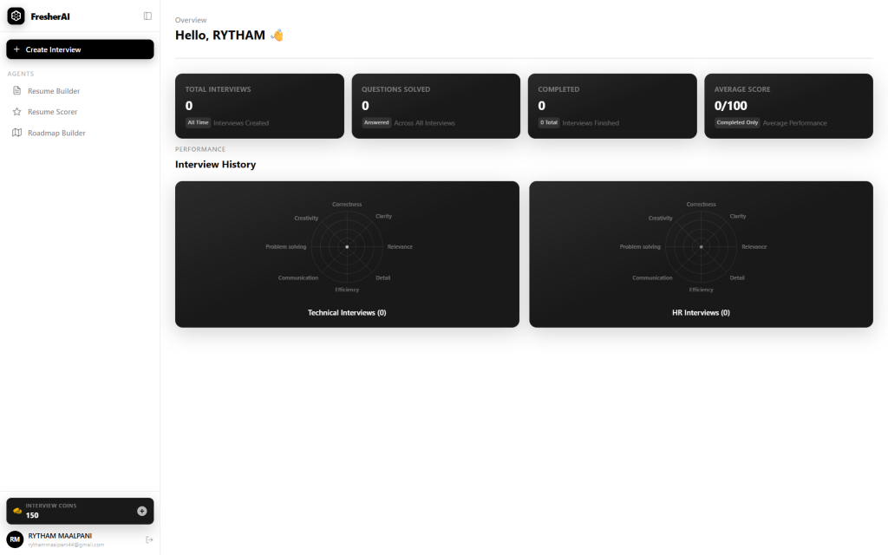
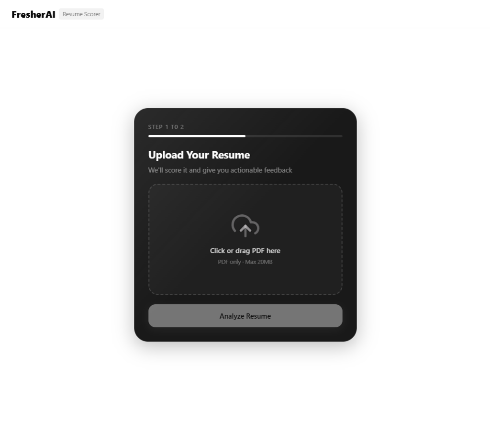
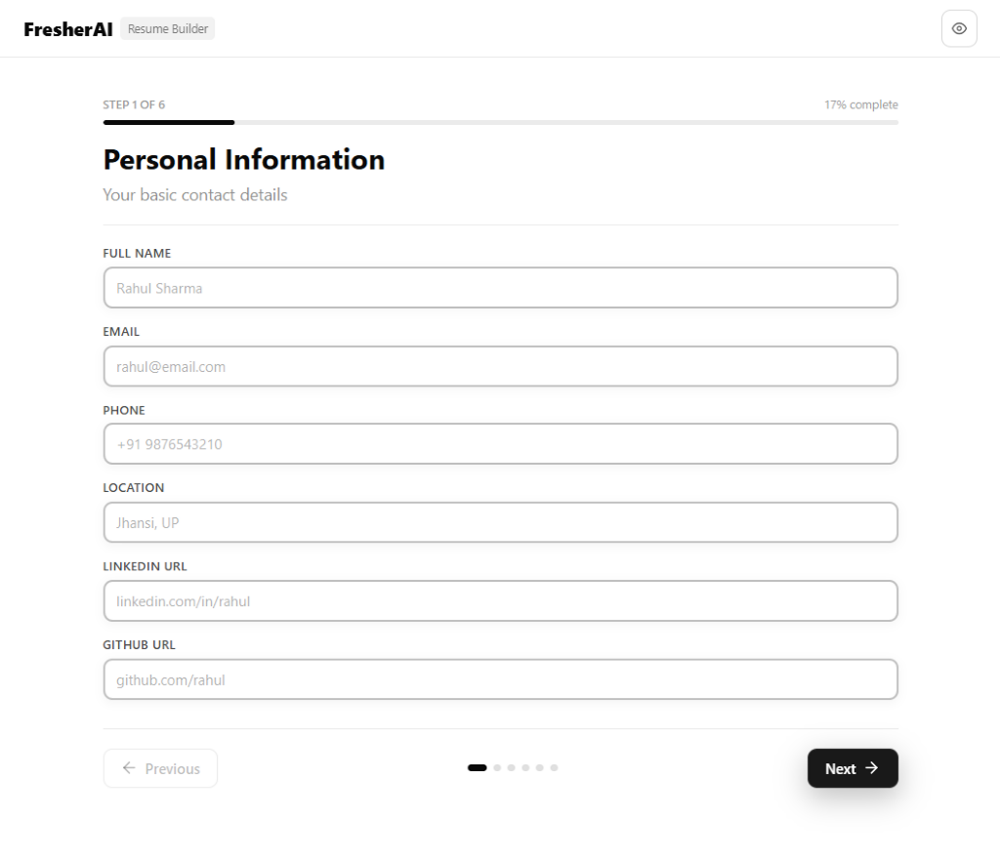
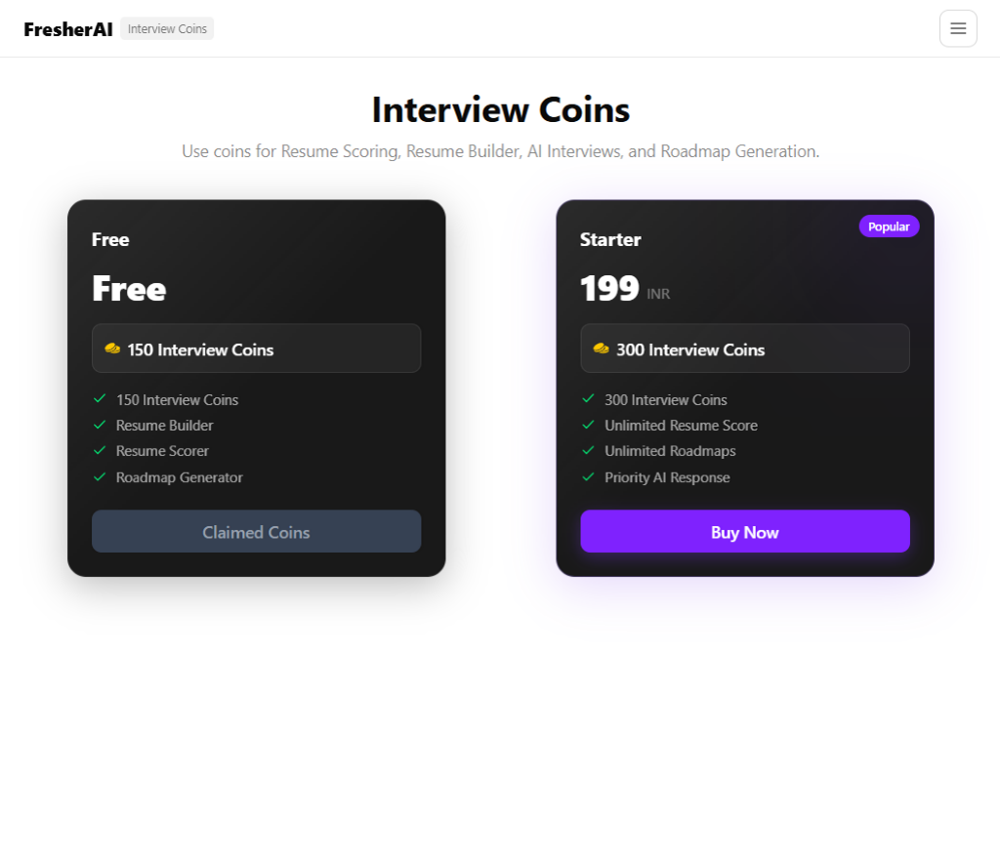

# FresherAI

FresherAI is a full-stack AI interview preparation platform built with React, Node.js microservices, LangGraph, Redis, and MongoDB. It helps job seekers evaluate their resumes against ATS criteria, build formatted resumes, practice voice and code-based mock interviews, and generate structured learning roadmaps with curated documentation and video links.

## Features

- **Google Authentication and Session Management**: Client-side Google sign-in via Firebase Authentication, verified on the backend using Firebase Admin SDK and persisted with Redis-backed HTTP-only session cookies.
- **Dashboard and Analytics**: Tracks total interviews, questions answered, completion count, average score, and 8-axis radar charts (Correctness, Clarity, Relevance, Detail, Efficiency, Communication, Problem Solving, Creativity) split by Technical and HR interviews.
- **AI Mock Interviews (Technical and HR)**: Uses a LangGraph workflow (`interviewAgent`, `feedbackAgent`, `summaryAgent`) to generate role-based questions (optionally tailored to the user's resume), evaluate answers in real time, and compile an end-of-session performance report.
- **Live Interview Workspace**: Includes browser text-to-speech (`speechSynthesis`), speech-to-text (`webkitSpeechRecognition`), optional webcam preview, per-question countdown timers, and an embedded Monaco code editor supporting JavaScript, Python, Java, and C++.
- **ATS Resume Scorer**: Accepts PDF uploads (up to 20 MB), extracts text with `pdf-parse`, and returns an ATS score (`0-100`), suggested role, strengths, weaknesses, missing skills, and recommendations.
- **Resume Builder**: 6-step form wizard (Personal Info, Summary, Skills, Work Experience, Projects, Education) with live ATS template preview and PDF export.
- **AI Learning Roadmap Generator**: Uses a two-stage LangGraph pipeline (`roadmapAgent` and `resourceAgent`) combined with the YouTube Data API v3 to generate module-by-module roadmaps tailored to a target role and package, along with saved roadmap history.
- **Interview Coins and Billing**: Credit-based usage system (150 free coins on signup; `-10` for Resume Scorer, `-10` for PDF downloads, `-20` for Roadmap Generation, `-50` for starting an AI Interview) with Razorpay Checkout integration and HMAC signature verification for purchasing coin packs.

## Screenshots

| Dashboard | Interview Setup |
| :---: | :---: |
|  |  |
| *User overview with interview stats and Technical/HR radar charts* | *Interview configuration with role, type, and resume personalization* |

| Resume Scorer | Resume Builder |
| :---: | :---: |
|  |  |
| *PDF upload screen for ATS scoring and feedback* | *Multi-step ATS resume builder wizard* |

| Roadmap Generator | Billing and Interview Coins |
| :---: | :---: |
|  |  |
| *Role and target-package roadmap generator with history drawer* | *Coin balance breakdown and Razorpay top-up plans* |

## Tech Stack

**Frontend**
- React 19, Vite 8, React Router v7
- Redux Toolkit, React Redux
- Tailwind CSS v4, Motion (`motion/react`), React Icons
- Axios, Recharts, Monaco Editor (`@monaco-editor/react`), `react-to-print`
- Firebase Web SDK, Razorpay Checkout script

**Backend and AI**
- Node.js (ES Modules), Express 5
- `express-http-proxy` (API Gateway routing and `x-user-id` header injection)
- LangGraph (`@langchain/langgraph`), LangChain Core (`@langchain/core`), Groq (`@langchain/groq`, `llama-3.3-70b-versatile`)
- MongoDB with Mongoose
- Redis (`ioredis`) via Docker Compose
- Firebase Admin SDK, Multer, `pdf-parse`, Razorpay Node SDK, YouTube Data API v3

## Architecture and Project Structure

All client requests go to the API Gateway (`http://localhost:8000`). Public auth routes proxy directly to the Auth service, while protected routes validate the `session` cookie against Redis in `isAuth` and inject the `x-user-id` header before forwarding to downstream services.

```text
2.fresherAI/
├── backend/
│   ├── docker-compose.yml              # Redis container definition
│   ├── package.json                    # Shared root dependency (ioredis)
│   ├── gateway/                        # API Gateway (port 8000)
│   │   ├── controllers/user.controller.js
│   │   ├── middleware/isAuth.js
│   │   ├── utils/proxyWithHeaders.js
│   │   └── index.js
│   ├── shared/
│   │   └── redis/redis.js              # Shared ioredis client
│   └── services/
│       ├── auth/                       # Auth, sessions, coin balance (port 8001)
│       ├── resume/                     # PDF parsing & ATS scoring (port 8002)
│       ├── interview/                  # LangGraph interview & feedback (port 8003)
│       ├── roadmap/                    # LangGraph roadmap & YouTube search (port 8004)
│       └── billing/                    # Razorpay orders & verification (port 8005)
├── frontend/
│   ├── src/
│   │   ├── apis/                       # Axios API helpers
│   │   ├── components/                 # Sidebar, LoginModel, interview, resume, roadmap UI
│   │   ├── pages/                      # Home, Dashboard, Scorer, ResumeBuilder, Interview, Roadmap, Billing
│   │   ├── redux/                      # Redux store and resume slice
│   │   └── utils/                      # Axios instance and Firebase client setup
│   └── package.json
└── screenshots/                        # Application screenshots for documentation
```

## Prerequisites

- **Node.js**: v20.10+ or v22+ (required for ES modules and JSON import attributes in the Auth service)
- **Docker** (for running the Redis container via Docker Compose)
- **MongoDB**: Local MongoDB instance or MongoDB Atlas connection string
- **External Accounts / API Keys**:
  - Firebase project with Google Sign-In enabled + a Firebase Admin service account JSON file
  - Groq API key (`llama-3.3-70b-versatile` access)
  - YouTube Data API v3 key (Google Cloud Console)
  - Razorpay test or live API keys

## Environment Configuration

Create `.env` files in the locations below using these templates. Do not commit real credentials.

### 1. API Gateway (`backend/gateway/.env`)

```env
PORT=8000
REDIS_URL="redis://localhost:6379"
AUTH_SERVICE_URL="http://localhost:8001"
RESUME_SERVICE_URL="http://localhost:8002"
INTERVIEW_SERVICE_URL="http://localhost:8003"
ROADMAP_SERVICE_URL="http://localhost:8004"
BILLING_SERVICE_URL="http://localhost:8005"
FRONTEND_URL="http://localhost:5173"
```

*(If Vite runs on a different port such as `5174`, update `FRONTEND_URL` to match so CORS allows requests with credentials.)*

### 2. Auth Service (`backend/services/auth/.env` + Service Account)

```env
PORT=8001
MONGODB_URL="your_mongodb_connection_string/user"
REDIS_URL="redis://localhost:6379"
```

Place your Firebase Admin SDK private key file at:

```text
backend/services/auth/serviceAccountKey.json
```

### 3. Resume Service (`backend/services/resume/.env`)

```env
PORT=8002
MONGODB_URL="your_mongodb_connection_string/resume"
REDIS_URL="redis://localhost:6379"
GROQ_API_KEY="your_groq_api_key"
```

### 4. Interview Service (`backend/services/interview/.env`)

```env
PORT=8003
MONGODB_URL="your_mongodb_connection_string/interview"
REDIS_URL="redis://localhost:6379"
GROQ_API_KEY="your_groq_api_key"
```

### 5. Roadmap Service (`backend/services/roadmap/.env`)

```env
PORT=8004
MONGODB_URL="your_mongodb_connection_string/Roadmap"
REDIS_URL="redis://localhost:6379"
GROQ_API_KEY="your_groq_api_key"
YOUTUBE_API_KEY="your_youtube_data_api_key"
```

### 6. Billing Service (`backend/services/billing/.env`)

```env
PORT=8005
MONGODB_URL="your_mongodb_connection_string/Billing"
RAZORPAY_KEY_ID="your_razorpay_key_id"
RAZORPAY_KEY_SECRET="your_razorpay_key_secret"
```

### 7. Frontend (`frontend/.env` + Firebase Config)

```env
VITE_FIREBASE_APIKEY="your_firebase_web_api_key"
VITE_RAZORPAY_KEY_ID="your_razorpay_key_id"
VITE_BACKEND_URL="http://localhost:8000"
```

Update the non-key Firebase project fields (`authDomain`, `projectId`, `storageBucket`, `messagingSenderId`, `appId`) in `frontend/src/utils/firebase.js` to match your own Firebase web app configuration.

## Installation and Running Locally

### 1. Install Backend Dependencies

Install the root `backend/` dependency (`ioredis` used by `backend/shared/redis/redis.js`), then install dependencies for the gateway and each microservice:

```bash
cd backend
npm install

cd gateway && npm install && cd ..
cd services/auth && npm install && cd ../..
cd services/resume && npm install && cd ../..
cd services/interview && npm install && cd ../..
cd services/roadmap && npm install && cd ../..
cd services/billing && npm install && cd ../..
```

### 2. Install Frontend Dependencies

```bash
cd frontend
npm install
```

### 3. Start Redis

From the `backend/` directory:

```bash
docker compose up -d
```

### 4. Start All Backend Services

Run each service in its own terminal (use `npm run dev` for `nodemon` watch mode or `npm start` for `node index.js`):

```bash
# Terminal 1 - Auth Service (8001)
cd backend/services/auth && npm run dev

# Terminal 2 - Resume Service (8002)
cd backend/services/resume && npm run dev

# Terminal 3 - Interview Service (8003)
cd backend/services/interview && npm run dev

# Terminal 4 - Roadmap Service (8004)
cd backend/services/roadmap && npm run dev

# Terminal 5 - Billing Service (8005)
cd backend/services/billing && npm run dev

# Terminal 6 - API Gateway (8000)
cd backend/gateway && npm run dev
```

### 5. Start the Frontend

```bash
cd frontend
npm run dev
```

Open the local URL printed by Vite (by default `http://localhost:5173`, matching `FRONTEND_URL` in `backend/gateway/.env`).

## API Overview

All frontend requests target the API Gateway (`http://localhost:8000`):

| Prefix | Downstream Service | Auth Required | Main Endpoints |
| :--- | :--- | :---: | :--- |
| `/api/me` | Gateway (reads Redis session) | Yes | `GET /api/me` |
| `/api/auth` | Auth (`8001`) | Mixed | `POST /login`, `GET /logout`, `POST /use-coins`, `POST /add-coins` |
| `/api/resume` | Resume (`8002`) | Yes | `POST /upload` (`multipart/form-data`, field `resume`), `GET /get-resume` |
| `/api/interview` | Interview (`8003`) | Yes | `POST /start`, `POST /answer`, `GET /all`, `GET /:id` |
| `/api/roadmap` | Roadmap (`8004`) | Yes | `POST /generate`, `GET /all`, `GET /:id` |
| `/api/billing` | Billing (`8005`) | Yes | `POST /create`, `POST /verify` |

## Future Improvements

- Add a unified `docker-compose.yml` setup or root dev runner script to start the gateway, all five microservices, Redis, and the frontend with one command.
- Make session cookie flags (`secure`, `sameSite`) environment-dependent in `backend/services/auth/controllers/auth.controller.js` so local plain-HTTP clients across all browsers retain cookies reliably.
- Load `dotenv/config` before static ESM imports in `gateway` and `services/auth` so `REDIS_URL` is available before `backend/shared/redis/redis.js` initializes in containerized deployments.
- Fetch existing resume data in `frontend/src/App.jsx` whenever `user` changes after login rather than only on initial mount, and surface login or upload errors inline instead of logging only to the console.
